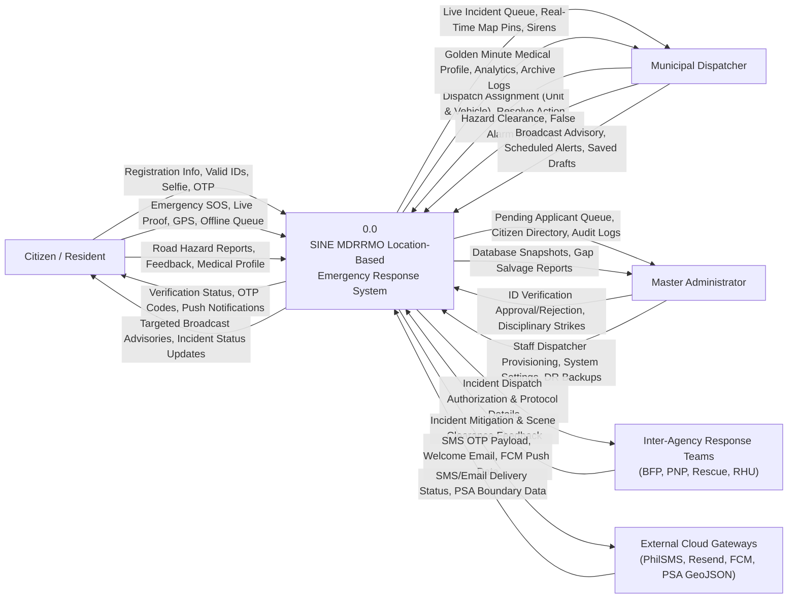
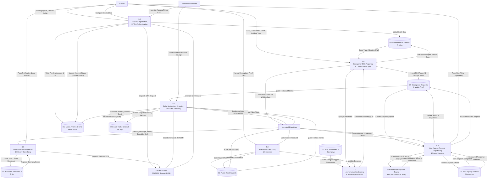

# Data Flow Diagrams (DFD)

This document provides the formal Data Flow Diagrams (Context Diagram Level 0 and System Decomposition Level 1) for the **SINE MDRRMO Location-Based Emergency Response System**, designed for inclusion in **Chapter 3 (System Methodology & Architecture)** of the capstone manuscript.

---

## 1. System Context and Entities

The system facilitates emergency response operations across the Municipality of San Isidro, Nueva Ecija. Data flows between the system boundary and five external entities:

1. **Citizen / Resident:** Initiates account registration, provides identity verification documents, submits emergency SOS alerts with camera and GPS evidence, logs non-emergency road hazards, and receives safety advisories.
2. **Municipal Dispatcher:** Monitors live incoming incidents on the operations desk, assigns response agencies and protocol directives, clears road hazards, and issues town-wide or barangay-scoped broadcasts.
3. **Master Administrator:** Reviews citizen government ID verifications, manages staff credentials, enforces disciplinary strikes, reviews feedback, and oversees disaster recovery backups.
4. **Inter-Agency Response Teams (BFP, PNP, Rescue, RHU):** Receives incident dispatch authorization, conducts on-scene mitigation, and coordinates incident clearance with dispatchers.
5. **External Cloud Services:**
   - **PhilSMS API:** Transactional SMS gateway delivering one-time passwords (OTP).
   - **Resend Mailer:** Transactional email gateway for email OTP and account verification notices.
   - **Firebase Cloud Messaging (FCM v1):** Push notifications for backgrounded mobile devices.
   - **Philippine Statistics Authority (PSA) GeoJSON:** Boundary definitions for ray-casting municipal territory validation.

---

## 2. DFD Level 0: Context Diagram

The Context Diagram establishes the overall boundary of the system (**0.0**) and diagrams all primary input and output data flows with external entities.

---

## 3. Data Stores Inventory

Data stores correspond to the normalized database tables in MariaDB (`emergencydb`) and server storage:

| Data Store ID | Data Store Name | Primary Tables / Files | Description |
| :--- | :--- | :--- | :--- |
| **D1** | Users, Profiles & KYC Verifications | `users`, `user_profiles`, `user_verifications` | Stores credentials, demographic data, and dual-sided valid ID proof files. |
| **D2** | Golden Minute Medical Profiles | `user_medical_profiles` | Stores emergency health data (blood type, allergies, conditions, PWD status). |
| **D3** | PSA Boundaries & Barangays | `barangays`, `san-isidro-barangays.geojson` | Reference geographic data for San Isidro's 9 official barangays. |
| **D4** | Emergency Requests & Media Proof | `emergency_requests`, `/storage/emergencies/` | SOS records, camera photos/videos, timestamps, status, and coordinates. |
| **D5** | Public Road Hazards | `hazards`, `/storage/hazards/` | Citizen hazard reports with photo evidence and clearance state. |
| **D6** | Inter-Agency Protocol Dispatches | `dispatch` | Municipal dispatch records, authorized response agencies, action notes, and deployment timestamps. |
| **D7** | Broadcast Advisories & Drafts | `broadcasts`, `broadcast_barangays` | Public alert records, draft composer entries, schedules, and media files. |
| **D8** | Audit Trails, Strikes & Backups | `false_alarm_strikes`, `feedback`, `backups/` | Disciplinary strike logs, community bug reports, and compressed database snapshots. |

---

## 4. DFD Level 1: System Decomposition Diagram

The Level 1 diagram decomposes the system into seven core functional processes and maps the exact data exchange between processes, entities, and data stores.

---

## 5. Detailed Functional Process Descriptions

### 1.0 Account Registration, KYC & Authentication
- **Function:** Handles resident onboarding, credential verification, dual-sided government ID capture, live selfie verification, multi-channel OTP delivery (PhilSMS/Resend), and role-based session management.
- **Inbound Data:** Registrant personal data, normalized phone number, password, government ID number, photos of ID (front and back), live selfie holding the ID, 6-digit OTP code, and administrator review actions.
- **Outbound Data:** Session bearer tokens, verification state changes, Welcome notifications, and SMS/Email OTP requests.
- **Data Stores:** Reads and writes to `D1` (User Accounts) and `D2` (Medical Profiles).

### 2.0 Authoritative Geofencing & Boundary Resolution
- **Function:** Executes server-side ray-casting point-in-polygon calculations against official PSA GeoJSON boundary coordinates to assign an authoritative barangay to every incoming coordinate.
- **Inbound Data:** Raw latitude and longitude coordinates submitted by citizen mobile devices.
- **Outbound Data:** Authoritative barangay identifier or out-of-bounds rejection error.
- **Data Stores:** Reads from `D3` (PSA Boundaries & Barangays).

### 3.0 Emergency SOS Reporting & Offline Queue Sync
- **Function:** Receives emergency alerts from citizens. In low-connectivity situations, the client stores reports locally in IndexedDB and dispatches them chronologically upon network restoration. It associates incoming coordinates with authoritative boundaries and attaches the citizen's medical profile.
- **Inbound Data:** GPS coordinates, incident category (Medical, Fire, Flood, Crime, Others), incident description, and live camera evidence (photos or 10-second video).
- **Outbound Data:** Real-time WebSocket incident events transmitted to dispatcher consoles, sound alert triggers, and emergency records.
- **Data Stores:** Writes to `D4` (Emergency Requests); reads from `D2` (Medical Profiles) and `D3` (Boundaries).

### 4.0 Inter-Agency Protocol Dispatching & Status Lifecycle
- **Function:** Enables dispatchers to assign appropriate response agencies (MDRRMO Rescue Team, San Isidro BFP, San Isidro PNP, RHU) and protocol action notes to active incidents. Manages the incident lifecycle (`Pending` -> `Dispatched` -> `Resolved`).
- **Inbound Data:** Dispatcher agency selection, coordination notes, and on-scene resolution confirmation.
- **Outbound Data:** Push notifications sent to citizens (`Dispatched`, `Resolved`), dispatch protocol records, and updated live map marker states.
- **Data Stores:** Reads and writes to `D4` (Emergency Requests) and `D6` (Inter-Agency Protocol Dispatches).

### 5.0 Road Hazard Reporting & Clearance
- **Function:** Ingests crowd-sourced reports of road obstructions, fallen trees, downed power lines, and flooded roads to assist municipal safety awareness and route planning.
- **Inbound Data:** Hazard category, photo/video proof, location coordinates, and dispatcher clearance confirmation.
- **Outbound Data:** Active hazard markers on dispatcher maps and citizen community hazard feeds.
- **Data Stores:** Reads and writes to `D5` (Public Road Hazards); reads from `D3` (Boundaries).

### 6.0 Public Advisory Broadcast & Delivery Scheduling
- **Function:** Manages the creation, draft review, scheduling, and transmission of municipal emergency broadcasts. Supports town-wide broadcasts or scoped deliveries targeting specific barangays.
- **Inbound Data:** Announcement headline, body text, up to 4 attached images or videos, target barangays, delivery schedule timestamp (`scheduled_at`), and draft status flag.
- **Outbound Data:** Push notifications via Firebase Cloud Messaging, active alert banners on citizen home dashboards, and scheduled release queues.
- **Data Stores:** Reads and writes to `D7` (Broadcast Advisories & Drafts).

### 7.0 Strike Moderation, Analytics & Disaster Recovery
- **Function:** Enforces the 3-strike disciplinary policy for verified false alarms, generates aggregated operational charts (incident volume, response distribution, hazard frequency), and executes automated database backup snapshots and delta gap salvaging.
- **Inbound Data:** Dispatcher false alarm confirmation, administrative date range queries, backup CLI commands (`create`, `restore`, `salvage`, `notify`).
- **Outbound Data:** Automated citizen account suspensions (strike 3), Chart.js data visualizations, downloadable certified situation summary PDFs, compressed `.sql.gz` archives, and recovery gap SMS/email notifications.
- **Data Stores:** Reads and writes to `D1` (User Accounts), `D4` (Emergency Requests), `D5` (Hazards), and `D8` (Audit & Backups).
