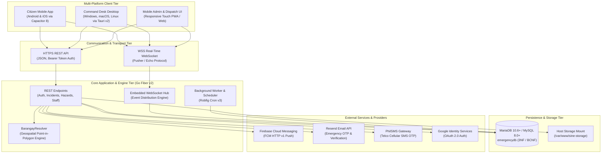

# Technology Stack Architecture: SINE MDRRMO Emergency Response System

This document outlines the complete, categorized technology stack for the **SINE MDRRMO Location-Based Emergency Response System** (Version `0.93.4`). It is structured for presentation decks, system architecture defense, and technical evaluation.

---

## 1. High-Level Architecture Overview

The system employs a decoupled, multi-tier client-server architecture connecting citizens, first responders, and emergency dispatchers in real time over secure HTTPS and WSS (WebSocket Secure) connections.

---

## 2. Categorized Technology Stack

### Tier 1: Frontend Client Framework & UI

The frontend client layer powers both citizen mobile reporting interfaces and dispatcher operations consoles from a single unified codebase.

| Technology | Version | Category / Role | Architectural Purpose & Rationale |
| :--- | :--- | :--- | :--- |
| **Angular** | `20.0.0` | Frontend Framework | Enterprise-grade single-page application (SPA) platform providing strict TypeScript typing, reactive signals, dependency injection, and modular route guards. |
| **Ionic Framework** | `8.0.0` | Mobile UI Toolkit | Cross-platform mobile UI component suite delivering native iOS and Material Design styling, touch interactions, modal dialogs, and gestures. |
| **TypeScript** | `5.9.0` | Programming Language | Statically typed language superset enforcing compile-time correctness across all client services, models, and component interfaces. |
| **RxJS** | `7.8.0` | Reactive Stream Library | Event-driven observable pipelines handling asynchronous user inputs, live WebSocket streams, location watchers, and HTTP request orchestration. |
| **Tailwind CSS & SCSS** | Modern | Styling Engine | Utility-first styling coupled with modular Sassy CSS for custom design tokens, dark mode adaptation, and responsive layouts. |
| **Motion** | `13.0.0` | Animation Engine | Hardware-accelerated fluid transitions for emergency cards, modal overlays, map pull-sheets, and interactive feedback indicators. |
| **Chart.js** | `4.5.1` | Visual Analytics | High-performance HTML5 Canvas rendering for municipal incident response trends, hazard distribution charts, and dispatch response time metrics. |
| **ngx-image-cropper** | `9.1.6` | Client Media Utility | In-browser/in-app cropping and aspect-ratio alignment for citizen dual-sided government ID uploads and profile photos. |

---

### Tier 2: Mobile Runtime & Native Device Integrations

Enables the Angular/Ionic web codebase to run natively on mobile operating systems with direct access to hardware sensors and device capabilities.

| Technology | Version | Category / Role | Architectural Purpose & Rationale |
| :--- | :--- | :--- | :--- |
| **Capacitor** | `8.4.0` | Cross-Platform Native Bridge | Modern native bridge providing direct access to native Android and iOS APIs while maintaining web standards compliance. |
| **Capacitor Geolocation** | `8.2.0` | GPS Location Bridge | High-accuracy GPS positioning capturing coordinates for emergency dispatch, locked during photo and video capture. |
| **Capacitor Camera** | `8.2.0` | Hardware Camera Bridge | Direct camera access for real-time proof capture (anti-prank protocol requiring live camera evidence without gallery uploads). |
| **Capacitor Push Notifications** | `8.1.1` | Native Push Handler | Handles Firebase Cloud Messaging (FCM) tokens and delivers critical emergency notifications when the app is in the background or killed. |
| **Capacitor Haptics** | `8.0.2` | Tactile Feedback | Hardware vibration and haptic feedback confirming SOS button holds, state transitions, and critical dispatch events. |
| **Capacitor Android SMS Retriever** | `0.1.1` | Security / Auth Utility | Zero-permission SMS OTP auto-fill via Google Play Services SMS Retriever API for seamless citizen phone verification. |
| **Capacitor Status Bar & Keyboard** | `8.0.x` | Native UI Polish | Dynamic edge-to-edge system bar coloring, dark mode bar styling, and keyboard overlap prevention. |

---

### Tier 3: Desktop Runtime & Command Desk

Provides native desktop performance for municipal operations desks, dispatchers, and administrators.

| Technology | Version | Category / Role | Architectural Purpose & Rationale |
| :--- | :--- | :--- | :--- |
| **Tauri** | `2.0+` | Native Desktop Framework | Rust-powered desktop application wrapper utilizing OS native webviews (WebView2 on Windows, WebKit on macOS/Linux) with negligible memory footprint (~30MB RAM vs. 200MB+ in Electron). |
| **Rust** | `2021 Edition` | Systems Language | Underpins the Tauri desktop binary with memory safety, zero-cost abstractions, and hardware-level performance. |
| **Tauri Plugin Notification** | `2.8.0` | Native OS Notification | Emits system-level desktop notification banners with custom incident alert sounds directly through the host OS notification manager. |
| **Windows NSIS & Portable** | Modern | Windows Installer / Executable | Generates Windows `.exe` installers with desktop shortcuts and standalone zero-install portable executables. |
| **macOS Universal & DMG** | Modern | macOS Application Bundle | Produces universal binaries supporting both Apple Silicon (ARM64 M1-M4) and Intel (x86_64) architectures. |
| **Linux DEB & AppImage** | Modern | Linux Distribution Packages | Generates Debian/Ubuntu `.deb` packages and distro-agnostic standalone `.AppImage` binaries. |

---

### Tier 4: Geospatial & Offline Mapping Stack (GIS)

Handles emergency coordinate mapping, polygon boundaries, and offline disaster navigation.

| Technology | Version | Category / Role | Architectural Purpose & Rationale |
| :--- | :--- | :--- | :--- |
| **Leaflet** | `1.9.4` | Interactive Web Mapping | Lightweight, open-source JavaScript mapping library powering incident mapping, custom marker rendering, clustering, and route visualization. |
| **PMTiles** | `4.5.0` | Serverless Map Archive | Single-file archive format for vector and raster map tiles. Enables offline tile reads via HTTP range requests or local disk storage during complete network outages. |
| **GeoJSON** | RFC 7946 | Spatial Geometry Standard | Structured geographic representations of San Isidro's municipal perimeter and 9 barangay boundary polygons. |
| **BarangayResolver** | Custom Go | Point-in-Polygon Engine | Server-side ray-casting algorithm validating whether incident GPS coordinates fall strictly inside municipal borders and determining the corresponding barangay. |

---

### Tier 5: Backend API & Real-Time Engine

The central micro-daemon orchestrating business logic, security authentication, spatial validation, and real-time broadcasting.

| Technology | Version | Category / Role | Architectural Purpose & Rationale |
| :--- | :--- | :--- | :--- |
| **Go (Golang)** | `1.23 / 1.24` | Backend Language | High-throughput, statically typed, compiled language offering lightweight concurrency (goroutines) and sub-millisecond execution times. |
| **Go Fiber** | `2.52.6` | HTTP Web Framework | High-performance web framework built atop FastHTTP, designed for extreme throughput and low memory footprint in high-concurrency environments. |
| **Fiber WebSocket Hub** | `1.3.4` | Real-Time Distribution | Embedded WebSocket engine supporting Pusher/Echo protocol. Pushes emergency state changes to connected clients in under 50ms without polling. |
| **GORM** | `1.25.12` | Object-Relational Mapper | Developer-friendly, robust ORM managing schema migrations, complex joins, and parameterized queries with built-in SQL injection defense. |
| **Robfig Cron** | `3.0.1` | Cron Job Scheduler | In-process cron engine executing scheduled tasks: broadcast expiration, automatic alert archival, and rate-limit cache refreshes. |
| **Zerolog** | `1.33.0` | Structured JSON Logger | Zero-allocation JSON logger outputting structured audit records for incident submissions, dispatcher actions, and security events. |
| **Go Crypto (Bcrypt)** | `0.31.0` | Cryptographic Security | Industry-standard password hashing using Adaptive Bcrypt (work factor 10+) to safeguard stored credentials. |

---

### Tier 6: Database & Data Persistence

The transactional relational data store adhering to strict normalization standards.

| Technology | Version | Category / Role | Architectural Purpose & Rationale |
| :--- | :--- | :--- | :--- |
| **MariaDB / MySQL** | `10.6+ / 8.0+` | Relational Database Engine | ACID-compliant relational database management system (`emergencydb`) enforcing referential integrity, foreign key cascades, and spatial indexes. |
| **InnoDB Engine** | Modern | Storage Engine | Row-level locking, crash recovery, and multi-version concurrency control (MVCC) preventing table locks during simultaneous incident filings. |
| **Composite B-Tree Indexes** | Modern | Query Optimization | Multi-column index structures (`(latitude, longitude)`, `(status, created_at)`) accelerating spatial bounding-box scans and dashboard queries. |
| **JSON Columns (`proof_files`)** | Modern | Flexible Attribute Storage | Controlled denormalization storing media proof metadata in single atomic rows during unstable rural network connectivity. |

---

### Tier 7: External Cloud Services & Third-Party APIs

Integrated external services providing identity verification, multi-channel alerting, and notification delivery.

| Technology | Provider / API | Category / Role | Architectural Purpose & Rationale |
| :--- | :--- | :--- | :--- |
| **Firebase Cloud Messaging** | Google Firebase | Mobile Push Notifications | Delivers high-priority push notifications via the FCM HTTP v1 protocol to Android and iOS devices even when apps are terminated. |
| **Resend API** | Resend | Transactional Email | Modern email delivery infrastructure sending authentication OTPs, account verification updates, and official dispatch advisories. |
| **PhilSMS Gateway** | PhilSMS | Telecommunication SMS | Direct SMS gateway integration transmitting verification OTPs and urgent municipal disaster alerts to Philippine telcos (Globe, Smart, DITO). |
| **Google Identity Services** | Google | OAuth 2.0 Single Sign-On | Secure Google OAuth 2.0 social login simplifying citizen onboarding while verifying genuine account identities. |

---

### Tier 8: DevOps, CI/CD, & Release Automation

Automated infrastructure ensuring build integrity, reproducible testing, and continuous delivery across all target operating systems.

| Technology | Category / Role | Architectural Purpose & Rationale |
| :--- | :--- | :--- |
| **GitHub Actions** | CI/CD Pipeline Automation | Automated workflow matrix triggering on tag releases to build, test, and bundle Android APKs, Windows installers, macOS DMGs, and Linux packages. |
| **Docker & Docker Compose** | Containerization | Standardized container recipes facilitating reproducible server deployments across local staging and remote Linux VPS environments. |
| **Node.js & npm** | Package & Build Tooling | Frontend dependency management, Angular CLI build compilation, and asset bundling. |
| **Cargo & Rust Toolchain** | Native Systems Compiler | Compiles, optimizes, and strips the Tauri Rust desktop runtime using Link-Time Optimization (LTO). |
| **Go Toolchain** | Backend Compiler | Cross-compiles standalone static Go binaries for Linux x64 VPS deployment. |

---

## 3. Technology Stack Summary Matrix (Presentation Slide Reference)

This table provides a concise, structured overview suitable for slides and presentation visual aids:

| Tier | Primary Technologies | Key Versions | Core Function |
| :--- | :--- | :--- | :--- |
| **Citizen Mobile** | Ionic, Angular, Capacitor | `v8.0`, `v20.0`, `v8.4` | Cross-platform SOS reporting, camera proof, and emergency alerts on Android and iOS. |
| **Dispatcher Desktop** | Tauri, Rust, Leaflet | `v2.0`, `2021`, `v1.9` | Low-memory desktop command desk for Windows, macOS, and Linux operations. |
| **Backend Service** | Go, Go Fiber, WebSockets | `v1.23+`, `v2.52` | Sub-millisecond REST API and real-time bidirectional emergency event broadcasting. |
| **Geospatial & Mapping** | Leaflet, PMTiles, GeoJSON | `v1.9.4`, `v4.5` | Authoritative server point-in-polygon boundary validation and offline map rendering. |
| **Database** | MariaDB / MySQL, GORM | `v10.6+`, `v1.25` | Normalized relational storage (`emergencydb`) with foreign key constraints and ACID safety. |
| **Cloud Services** | Firebase (FCM), Resend, PhilSMS | HTTP v1, REST | Multi-channel alert dispatching across push notifications, email, and cellular SMS. |
| **DevOps & CI/CD** | GitHub Actions, Docker, Cargo | Multi-Arch | Multi-platform build pipeline delivering pre-compiled installers on GitHub Releases. |

---

## 4. Key Architectural Trade-Offs & Defense Justifications

Anticipated technical defense questions and architectural rationales for presentation panels:

### Q1: Why Go Fiber instead of PHP/Laravel or Node.js/Express?
- **Throughput & Concurrency**: Go natively handles tens of thousands of concurrent requests via lightweight goroutines (~2KB stack size vs. 1MB+ thread size). In high-volume disaster filings (e.g., severe typhoons or earthquakes), Go Fiber handles incoming SOS calls with latencies under 15ms while consuming under 50MB RAM.
- **Embedded WebSockets**: Go Fiber includes an embedded high-performance WebSocket hub, eliminating the need for an external Redis server or socket daemon.

### Q2: Why Tauri instead of Electron for the Desktop Application?
- **Resource Footprint**: Electron bundles a dedicated Chromium browser and Node.js runtime into every build, consuming 200MB to 500MB RAM at idle. Tauri leverages the OS-native webview and a compiled Rust backend, idling at just 25MB to 35MB RAM.
- **Installer Size**: Tauri installers are approximately 15MB to 20MB, compared to 90MB to 150MB for Electron distributions.

### Q3: Why PMTiles and Leaflet instead of Google Maps Platform?
- **Zero Cost & No API Keys**: Google Maps charges per tile request, creating recurring municipal budget constraints. Leaflet with OpenStreetMap / PMTiles has zero recurring licensing fees.
- **Offline Resilience**: Commercial cloud map APIs require continuous internet connectivity. PMTiles allows entire municipal map tile packages to be stored locally or cached on-premises, enabling full offline map rendering during post-typhoon internet blackouts.

### Q4: Why MariaDB/MySQL instead of NoSQL (MongoDB)?
- **ACID Transactions**: Emergency response, ID verifications, and responder deployments require strict ACID transaction guarantees. A citizen ID cannot be approved without an atomic update to verification logs and user roles.
- **Referential Integrity**: Relational foreign keys prevent orphan records (e.g., dispatch records without a corresponding emergency request).
