# UML Use Case Diagram and Specifications

This document defines the formal Unified Modeling Language (UML) Use Case Diagram and operational specifications for the **SINE MDRRMO Location-Based Emergency Response System**, designed for inclusion in **Chapter 3 (System Architecture & Modeling)** of the capstone manuscript.

---

## 1. Actors and Roles

The system identifies five primary and supporting actors:

| Actor | Type | Description |
| :--- | :--- | :--- |
| **Citizen (Resident)** | Primary Human Actor | Resident of San Isidro submitting emergency SOS alerts, reporting public road hazards, configuring medical profiles, and receiving targeted public advisories. |
| **Municipal Dispatcher** | Primary Human Actor | Operational officer at the MDRRMO Operations Desk responsible for monitoring live incidents, dispatching responder units and vehicles, clearing road hazards, and drafting broadcasts. |
| **Master Administrator** | Primary Human Actor | Superadmin with master authority managing citizen identity verification (KYC), staff accounts, disciplinary strikes, system settings, and disaster recovery backups. |
| **Field Responders & Fleet** | Secondary Supporting Actor | Response teams (San Isidro BFP, PNP, MDRRMO Rescue, RHU) and specialized vehicles receiving dispatch coordinates and reporting on-scene status. |
| **External Cloud Gateways** | Supporting System Actor | Automated services providing SMS OTP delivery (PhilSMS), transactional emails (Resend), mobile push notifications (FCM v1), and PSA boundary verification. |

---

## 2. UML Use Case Diagram

```mermaid
flowchart TD
    %% Actors
    Citizen(["Citizen / Resident"])
    Dispatcher(["Municipal Dispatcher"])
    Admin(["Master Administrator"])
    Responders(["Field Responders & Fleet<br/>(BFP, PNP, Rescue, RHU)"])
    Cloud(["External Gateways<br/>(PhilSMS, Resend, FCM, PSA)"])

    subgraph SystemBoundary ["SINE MDRRMO Emergency Response System"]
        %% Subsystem 1: Identity & Authentication
        UC_Reg(["UC-01: Register Account & Submit Valid ID"])
        UC_OTP(["UC-02: Verify Multi-Channel OTP"])
        UC_Login(["UC-03: Authenticate Session (Password / OTP)"])
        UC_KYC(["UC-04: Review & Verify Citizen Identity"])
        UC_Med(["UC-05: Configure Golden Minute Medical Profile"])

        %% Subsystem 2: Emergency Response
        UC_SOS(["UC-06: Submit Emergency SOS Alert"])
        UC_Cam(["UC-07: Capture Live Camera Photo/Video Evidence"])
        UC_Geo(["UC-08: Resolve Authoritative PSA Boundary"])
        UC_Off(["UC-09: Queue SOS in Offline IndexedDB Store"])
        UC_Sync(["UC-10: Synchronize Queued Reports on Reconnect"])

        %% Subsystem 3: Operations & Dispatch
        UC_Live(["UC-11: Monitor Live Incident Map & Telemetry"])
        UC_Disp(["UC-12: Dispatch Linked Responder Unit & Vehicle"])
        UC_Stat(["UC-13: Update Incident Lifecycle (En Route / Resolved)"])
        UC_Haz(["UC-14: Report Public Road Hazard"])
        UC_HazClr(["UC-15: Clear & Resolve Road Hazard"])

        %% Subsystem 4: Broadcasts & Drafts
        UC_Bcast(["UC-16: Compose & Broadcast Public Advisory"])
        UC_Draft(["UC-17: Manage & Review Saved Broadcast Drafts"])
        UC_Sched(["UC-18: Queue Scheduled Announcement"])

        %% Subsystem 5: Moderation & Disaster Recovery
        UC_Strike(["UC-19: Enforce 3-Strike False Alarm Moderation"])
        UC_Staff(["UC-20: Provision & Manage Dispatcher Accounts"])
        UC_Arch(["UC-21: Search Log Archive & Export Certified PDF"])
        UC_DR(["UC-22: Execute Automated Backup & Gap Salvage"])
    end

    %% Citizen Associations
    Citizen --> UC_Reg
    Citizen --> UC_OTP
    Citizen --> UC_Login
    Citizen --> UC_Med
    Citizen --> UC_SOS
    Citizen --> UC_Haz

    %% Dispatcher Associations
    Dispatcher --> UC_Login
    Dispatcher --> UC_Live
    Dispatcher --> UC_Disp
    Dispatcher --> UC_Stat
    Dispatcher --> UC_HazClr
    Dispatcher --> UC_Bcast
    Dispatcher --> UC_Draft
    Dispatcher --> UC_Sched
    Dispatcher --> UC_Arch
    Dispatcher --> UC_Strike

    %% Admin Associations (Inherits Dispatcher + Admin Exclusives)
    Admin --> UC_Login
    Admin --> UC_KYC
    Admin --> UC_Staff
    Admin --> UC_DR
    Admin --> UC_Live
    Admin --> UC_Disp
    Admin --> UC_Arch

    %% Field Responders Associations
    UC_Disp -.-> Responders
    UC_Stat -.-> Responders

    %% External Gateways Associations
    UC_OTP -.-> Cloud
    UC_Geo -.-> Cloud
    UC_Bcast -.-> Cloud
    UC_Stat -.-> Cloud

    %% Include & Extend Relationships
    UC_Reg -.->|"<<include>>"| UC_OTP
    UC_SOS -.->|"<<include>>"| UC_Cam
    UC_SOS -.->|"<<include>>"| UC_Geo
    UC_SOS -.->|"<<include>>"| UC_Med
    UC_SOS -.->|"<<extend>>"| UC_Off
    UC_Off -.->|"<<include>>"| UC_Sync
    UC_Bcast -.->|"<<extend>>"| UC_Sched
    UC_Bcast -.->|"<<extend>>"| UC_Draft
    UC_Disp -.->|"<<include>>"| UC_Stat
```

---

## 3. Formal Use Case Specifications

### Use Case 01: Submit Emergency SOS with Mandatory Live Evidence
- **Use Case ID:** `UC-SOS-01`
- **Primary Actor:** Citizen / Resident
- **Secondary Actors:** Municipal Dispatcher, External Gateways (PSA GeoJSON, Firebase Cloud Messaging)
- **Pre-conditions:**
  1. Citizen is logged in with an active, approved account (`account_status = 'active'`).
  2. Device GPS receiver is operational.
  3. Citizen has granted camera and location permissions.
- **Main Flow (Normal Course):**
  1. Citizen taps the prominent red SOS button on the home dashboard or activates the 1-tap home screen widget (`sinemdrrmo://report`).
  2. The mobile client captures real-time device GPS coordinates.
  3. The system activates the live camera interface, enforcing real-time photo capture or 10-second video recording (gallery uploads are blocked).
  4. Citizen selects the emergency category (Fire, Flood, Medical, Crime, Others) and provides optional descriptive notes.
  5. Citizen confirms submission.
  6. The system retrieves the citizen's pre-configured "Golden Minute" medical profile (blood type, allergies, conditions, PWD status).
  7. The backend receives the payload and executes `BarangayResolver` ray-casting against PSA boundary polygons to confirm the incident lies within San Isidro.
  8. The incident record is committed to the database and broadcasted via WebSockets (`emergencies` channel) to all active dispatcher consoles.
  9. An audible siren triggers on dispatcher consoles, and a pulsing pin appears on the live Incident Map.
  10. Citizen receives a real-time submission confirmation.
- **Alternative Flow (Offline Network Outage):**
  - **7a.** Network connectivity check indicates zero cellular data/internet connection.
  - **7b.** The app delegates the payload (coordinates, category, description, and base64 media proof) to `OfflineQueueService`.
  - **7c.** The SOS alert is safely persisted inside client-side IndexedDB storage.
  - **7d.** A cautionary banner alerts the citizen that the report is queued locally and will automatically transmit the moment connection is re-established.
- **Post-conditions:**
  - Emergency incident is queued under active operations with status `Pending`.
  - Paramedics and dispatchers have immediate access to location and medical records.

---

### Use Case 02: Review and Verify Citizen Identity (KYC Pipeline)
- **Use Case ID:** `UC-KYC-02`
- **Primary Actor:** Master Administrator
- **Secondary Actors:** Citizen, External Gateways (PhilSys eVerify, LTO LTMS, DFA, PRC LERIS, Resend, FCM)
- **Pre-conditions:**
  1. Citizen has completed the 4-step registration wizard and verified their SMS/Email OTP (`account_status = 'unverified'`).
  2. Administrator is authenticated with `admin` token abilities.
- **Main Flow (Approval):**
  1. Administrator navigates to **ID Verifications** in the administrative dashboard.
  2. Administrator selects an applicant from the pending verification queue.
  3. The system presents high-resolution front and back photos of the government ID, the live selfie with ID, and applicant details.
  4. Administrator inspects document integrity and clicks the direct verification portal link (e.g. PhilSys eVerify or LTO LTMS) using 1-tap copied ID numbers.
  5. Administrator clicks **Approve User**.
  6. The backend updates the citizen's status to `account_status = 'active'`.
  7. A real-time WebSocket event (`users` channel: `UserVerified`) updates the citizen's pending screen immediately.
  8. The system dispatches an automated Welcome Email (via Resend) and an FCM push notification.
- **Alternative Flow (Rejection with Permanent PII Purge):**
  - **5a.** Administrator determines that the uploaded ID is fraudulent, blurred, or expired.
  - **5b.** Administrator enters a specific rejection reason and clicks **Reject User**.
  - **5c.** In compliance with RA 10173 (Data Privacy Act), the backend deletes all uploaded ID images from storage and purges database records, leaving zero residual personal data.
- **Post-conditions:**
  - Approved citizen can immediately log in and access emergency reporting.
  - Rejected application leaves no residual personal data on municipal servers.

---

### Use Case 03: Unit & Vehicle Fleet Dispatching
- **Use Case ID:** `UC-DISP-03`
- **Primary Actor:** Municipal Dispatcher
- **Secondary Actors:** Field Responders (BFP, PNP, Rescue, RHU), Citizen
- **Pre-conditions:**
  1. An emergency request is active in the operations queue with status `Pending`.
  2. Dispatcher is logged in on desktop or mobile.
- **Main Flow:**
  1. Dispatcher inspects the incoming incident card, reviewing GPS coordinates, camera proof, and Golden Minute medical notes.
  2. Dispatcher clicks **Dispatch**.
  3. The system displays linked dropdown menus: selecting a responder team (e.g. San Isidro BFP) strictly limits the vehicle dropdown to matching units (e.g. Fire Truck 01).
  4. Dispatcher confirms unit and vehicle assignment.
  5. The backend sets assigned units and vehicles to `in_use` status, synchronizing state across all active consoles to prevent double-assignment.
  6. Incident status transitions to `Dispatched` (`En Route`).
  7. Citizen receives a push notification stating responders are en route.
  8. Responders arrive on scene, mitigate the incident, and report completion.
  9. Dispatcher taps **Resolve Incident**.
  10. Incident transitions to `Resolved`, assigned units return to `Available`, and the record is moved to the searchable Log Archive.
- **Post-conditions:**
  - Emergency is marked completed with exact dispatch and resolution timestamps.
  - Responder units and vehicles are released back to available fleet inventory.

---

### Use Case 04: Confirmed False Alarm Disciplinary Strike
- **Use Case ID:** `UC-MOD-04`
- **Primary Actor:** Municipal Dispatcher / Administrator
- **Secondary Actor:** Citizen
- **Pre-conditions:**
  1. Field responders arrive at the reported incident coordinates and verify that no emergency occurred and the report was fraudulent or malicious.
  2. Incident is accessed via the Log Archive or active dispatch list.
- **Main Flow:**
  1. Dispatcher opens the incident details and clicks **Mark False Alarm**.
  2. The system prompts for operational confirmation and violation category notes.
  3. Dispatcher confirms the action.
  4. The backend increments the reporting citizen's strike counter (`false_alarm_strikes = false_alarm_strikes + 1`).
  5. The incident record is flagged with `is_false_alarm = true`.
- **Alternative Flow (Third Strike Automatic Suspension):**
  - **4a.** The updated strike count reaches 3.
  - **4b.** The backend automatically revokes all active session tokens and updates `account_status = 'banned'`.
  - **4c.** A permanent ban timestamp and reason are logged.
  - **4d.** The citizen's device is blocked from filing further emergency requests.
- **Post-conditions:**
  - Citizen accumulates an official disciplinary record; serial abusers are automatically barred from the emergency reporting network.

---

### Use Case 05: Public Advisory Broadcast & Scheduled Queueing
- **Use Case ID:** `UC-BCAST-05`
- **Primary Actor:** Municipal Dispatcher / Administrator
- **Secondary Actors:** Citizen, External Gateways (Firebase Cloud Messaging)
- **Pre-conditions:**
  1. Operator is authenticated with dispatcher or administrator role permissions.
- **Main Flow (Immediate Broadcast):**
  1. Operator navigates to the **Alert Broadcast** panel and expands the announcement composer card.
  2. Operator enters headline and advisory text (e.g. typhoon warning or evacuation notice).
  3. Operator selects target audience: **All Barangays** (town-wide) or one or more specific barangays (e.g. *Calaba*, *San Roque*).
  4. Operator attaches up to 4 photos or MP4 video clips via drag-and-drop or file selector.
  5. Operator clicks **Send Announcement**.
  6. The backend commits the broadcast to `broadcasts` and pivot table `broadcast_barangays`.
  7. The system pushes real-time WebSocket events and FCM notifications strictly to citizens registered within the targeted barangays.
  8. An advisory banner appears immediately on the home screens of affected citizen devices.
- **Alternative Flow (Save as Draft or Schedule for Later):**
  - **5a.** Operator chooses **Schedule for Later**, selects a future date and time, and confirms. The announcement is queued in the Scheduled Alerts queue and releases automatically at `scheduled_at`.
  - **5b.** Operator clicks **Save as Draft**. The advisory is stored in the **Saved Drafts** queue for supervisory review without notifying citizens.
- **Post-conditions:**
  - High-priority safety advisory is delivered to the targeted population without alarming unaffected barangays.
